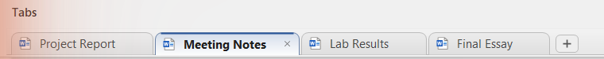

# Office Tabs Lite

Tabs for Microsoft Word, Excel and PowerPoint: a tab strip under the ribbon with one tab per open file, all files in one window and one taskbar button.



## Features

- One tab per open file, with the file-type icon; click to switch, `×` or middle-click to close.
- `+` or double-click the empty space for a new file, with a slide-in animation.
- Right-click menu: Save, Save All, Close Other Tabs, Close Tabs to the Right, Close All, Copy Full Path, Open Containing Folder, Tab Color.
- Unsaved-changes dot, tab colors, drag to reorder, full path on hover.
- One window position and one taskbar button for all files of an app.
- Three tab styles (Rounded, Trapezoid, Flat).
- **Office Tabs Lite Center** settings app: turn tabs on or off per app, appearance, reset and repair.

The full illustrated guide (Arabic) is in [guide/OfficeTabsLite-Guide.html](guide/OfficeTabsLite-Guide.html).

## Requirements

- Windows 10 or 11
- Microsoft Office 2013 or newer (tested on Office 2024, 64-bit)
- .NET Framework 4.x (included in Windows)
- No administrator rights: everything installs per user

## Install

Download `OfficeTabsLite-Setup.exe` from the Releases page, close Office, and run it.
Uninstall from Settings > Apps, or run the setup again and choose **No**.

## Build from source

No Visual Studio needed; the build uses the C# compiler that ships with Windows and the Office interop assemblies from the GAC.

```powershell
powershell -ExecutionPolicy Bypass -File src\build.ps1
```

Output goes to `build\` (add-in DLL and Center) and `dist\` (installer).

| File | What it is |
| --- | --- |
| `src/OfficeTabsLite.cs` | COM add-in: tab strip (custom task pane), window grouping, menu, settings |
| `src/Center.cs` | Settings app |
| `src/Installer.cs` | Self-contained installer (embeds the DLL and the Center) |
| `src/build.ps1` | Build script |
| `src/make-icon.ps1` | Generates `assets/OfficeTabsLite.ico` |

## Disclaimer

Independent project, not affiliated with Microsoft. Word, Excel, PowerPoint and Office are trademarks of Microsoft Corporation.

---

## بالعربي

إضافة لبرامج Word و Excel و PowerPoint بتضيف شريط تبويبات تحت الـ Ribbon، فيه تبويب لكل ملف مفتوح، وكل الملفات في نافذة واحدة وزر واحد على شريط المهام. شرح كامل بالصور في [الدليل](guide/OfficeTabsLite-Guide.html).

## License

[MIT](LICENSE)
